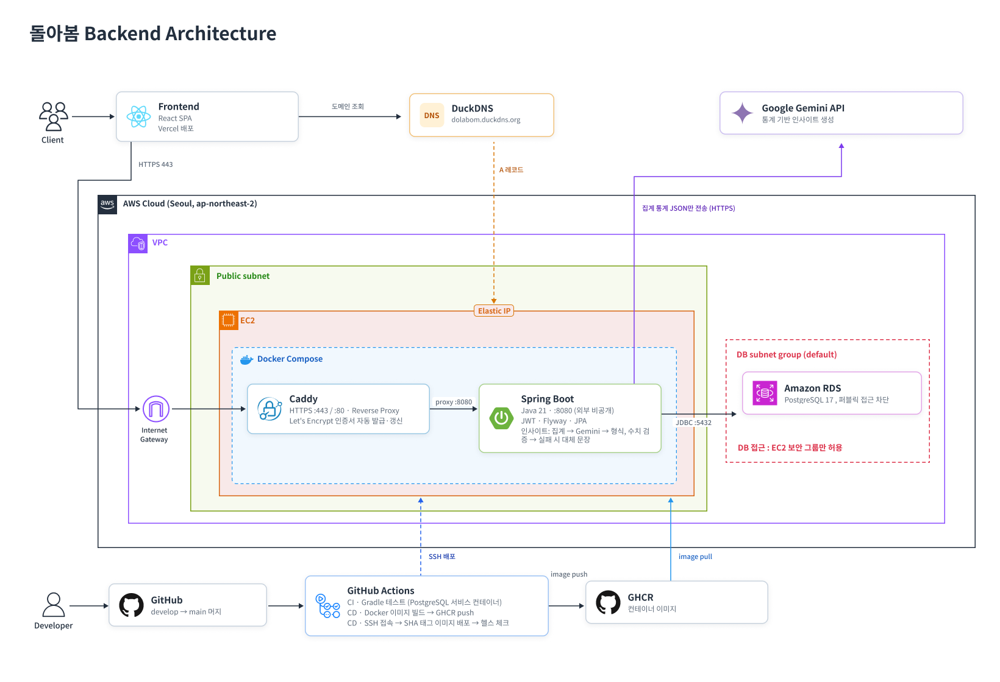
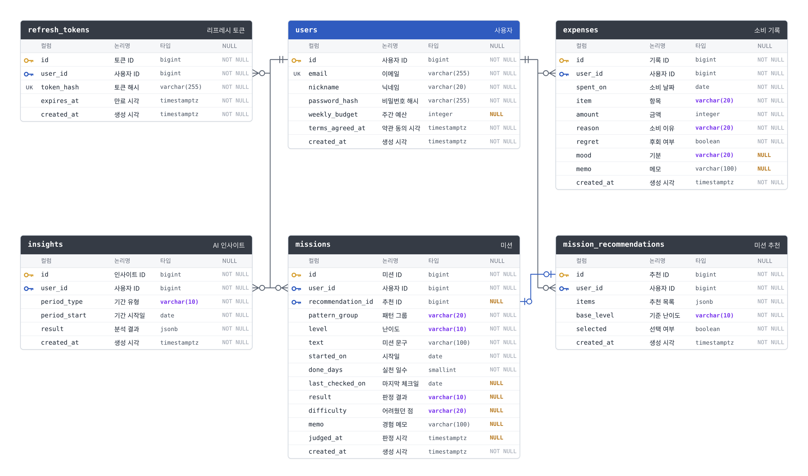
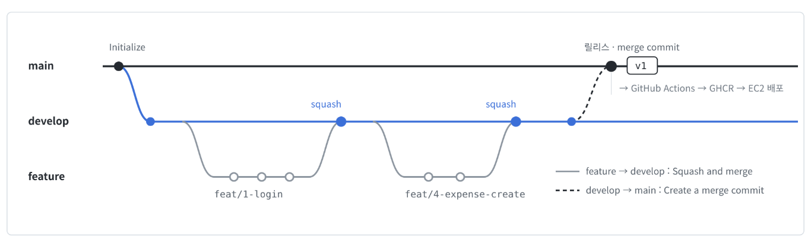

# 돌아봄 Backend

멋쟁이사자처럼 14기 1호선톤 출품작 "돌아봄"의 API 서버입니다.
'얼마 썼는지'가 아니라 '왜 썼는지'를 함께 돌아보는 AI 소비 성장 서비스입니다.

- 서비스: https://dolabom-line1.vercel.app
- Swagger: https://dolabom.duckdns.org/swagger-ui.html

## 아키텍처

## ERD

## 기술 스택

- Java 21, Spring Boot 4.1, Spring Data JPA, Spring Security (JWT)
- PostgreSQL 17, Flyway
- Google Gemini API
- AWS EC2, RDS, Docker Compose, Caddy
- GitHub Actions, GHCR

## 브랜치 전략

